# Priority 0: test-guided mechanism synthesis for trading control

Date: 2026-10-28 (America/Bogota)
Status: DESIGN PROPOSAL FOR INDEPENDENT AUDIT; not implemented or qualified.
Owner: Musashi. Reviewer: Satoshi.

Owner correction, 2026-10-28: there is NO strategy-imposed daily entry cap.
Three or more daily openings are allowed if all other constraints permit them.
The earlier one-entry/day proposal and the brief owner selection of that option
were superseded after its meaning was clarified. The source is now
`mechanism_synthesis/BUSINESS_CONTRACT.json`; this is a design correction, not
a deployed change or a reinterpretation of old experiments.

## 1. Decision and scope

The user makes strategy definition the highest priority. Design a resource
allocation mechanism, solve the induced finite policy games, measure their
Pareto efficiency and unilateral-deviation stability, and test the resulting
controller before spending on financial model selection or new architecture
sweeps. This document supersedes the next-action ordering in plans 110/111;
their evidence and the multiscale-input proposal remain unchanged.

Deliverable now: this implementation proposal and its audit request, not a
claim that a mechanism, Nash equilibrium, or profitable strategy was produced.
No campaign is launched, cancelled or restarted by this documentation change.
The planning hold is not a claim that remote services have been stopped.

Do not infer that every old result is invalid or that market data have no
signal. Existing results have their original scope. In particular, the recent
learned-close candidate matched a TRAIN-selected fixed clock; use that clock
as a mandatory control. Existing execution tests do not establish learned
decision quality or optimality of a new mechanism.

## 2. Known baseline versus new work

Existing code includes categorical action transport and legal masks in
`env_plugins/hybrid_orders.py`, categorical/conditional-Beta policies in
`agent_plugins/hybrid_orders.py`, fixed directional risk calibration in
`app/directional_risk_calibration.py`, and fixed-delay controls in
`app/exit_delay_control.py`. None implements the proposed 20-expert mechanism.
`tools/exit_learning_repair.py` and `tools/rescore_exit_delay.py` provide prior
diagnostic evidence, not an implementation to relabel as this experiment.

The earlier chat proposals of five actions per scale, mandatory three-member
ensembles, a universal 24-hour payoff horizon, and an uncertainty-only auction
are not binding implementation contracts. The specification below replaces
them. No compulsory ensemble size or new learned financial evaluator is
introduced in phase M0-M3.

## 3. Participants, signals and resources

There are 20 logical experts: `{AB, AS, CB, CS} x {1,2,6,12,24}`.
AB/AS propose opening long/short; CB/CS propose closing long/short. Each
reports two probabilities (abstain-or-maintain, act) and their uncertainty.
NOP while flat and HOLD while positioned are explicit reference alternatives,
not compulsory extra neural networks. Eligibility counts: flat 10+1;
long 5+1; short 5+1. All experts are queried at each hourly decision.

Signal contract, per batch:

| Field | Shape/type | Meaning |
|---|---|---|
| probabilities | float `[B,20,2]` | finite, in [0,1], last axis sums to one |
| uncertainty | float `[B,20,2]` | common declared definition and scale [0,1] |
| available_at | timestamps `[B,20]` | must not exceed decision time |
| valid | bool `[B,20]` | invalid expert is excluded, not mapped to confidence |
| expert_id | 20 unique identifiers | action, scale, producer identity |
| uncertainty_definition | versioned metadata | method, normalization, calibration identity |

Assume this interface is supplied by the upstream model, as requested. Design
does not depend on Bayesian heads versus MC dropout versus ensembles. A value
0.9 for acting is not a 90% win probability. Normalized uncertainty is not
expected PnL uncertainty. Synthetic signal generators exercise the interface;
real producers later prove availability and calibration without changing it.

Scale is a strategy identity, not a mandatory holding time. In the initial
synthetic clock, a scale means elapsed hours. The real-data consumer must
explicitly declare elapsed-hour versus observed-market-bar sampling; it must
never silently equate them across closures. This work does not change input
windows, scaler constants or feature selection.

Full engine state contains balance, equity, margin, position, side, fills,
SL/TP and calendar. It is available to the controller and resource
accounting, not concatenated to the neural market encoder. Whether market-only
expert signals suffice for position-dependent closing is an explicit test,
not an assumption. A failure requires a reported design decision, not hidden
state feedback.

Resources: one occupied position slot; locked margin; allowed planned-loss
exposure; time during which alternatives are unavailable. Margin and the slot
are released at exit. There is no daily entry-quota resource in this base game.
Profit is an outcome credited once to the common account, not a second resource
or separate payment to every participating expert.

Baseline constraints: capital 10000 account-currency units, rel_volume 0.1,
leverage 50, max one simultaneous position and no daily entry cap; no entries until 12 hours
after weekly reopening, forced flat 12 hours before weekly close. The admitted
calendar and account conversion rules decide exact times and units. Activity
of at least two completed trades/week averaged over an eligible period remains
a separately reported eligibility rule, never a reward for needless orders.
Scenario-specific NOP tests are not failed for lacking trades.

## 4. Mechanism and player policies

Separate frozen-reporter allocation tests from an adaptive policy game.
Frozen neural reports alone do not constitute strategic players changing bids.
In the finite game, each expert chooses a causal participation policy from an
enumerated library; only subsequently may a learner implement that policy.

Each library member specifies an action threshold and uncertainty ceiling;
an opener additionally chooses one of the permitted risk profiles. A closer
chooses a closing participation rule. The reference member always abstains.
Reports themselves are not arbitrarily rewritten to win. A dedicated
misreporting attack evaluates robustness; it does not prove truthful incentives.

Mechanism M(theta) determines eligibility, arbitration, resource reservation,
execution order, attribution and player utility. Two initial mechanism families:

* `threshold_margin`: rank eligible proposals by
  `p_act - threshold_role - lambda_role * u_act`; require score > 0.
* `reliability_adjusted`: map `(p_act,u_act)` through a calibration-only
  reliability table before applying the same rule. This table estimates a
  defined action-correctness event, not profit, and is sealed before confirmation.

These are deliberately hypotheses, not claimed solutions. NOP/HOLD have score
zero. Stable keyed tie-breaking must be independent of expert array order;
mirrored tests couple the random draw under the direction permutation.
Legality and forced protection override scores. One decision cannot close and
reopen in the first proposed mechanism; a later hourly decision may open if
the session and resources permit it. This scheduling choice is a mechanism
variant, not a daily quota or an additional owner-defined business restriction.

Positioned arbitration ignores opener bids. All five matching-side closers can
propose exit regardless of the opener's scale. Five identical immediate-close
proposals produce one physical outcome; attribution does not multiply profits.
The opener cannot veto a close, and mandatory exits need no learned permission.

Future economic-value arbitration is a separate mechanism family requiring its
own causal estimator. It is not silently assumed available for the first build.

## 5. Parameter ownership and risk calculation

| Owner | Configurable fields | Initial treatment |
|---|---|---|
| Player library | action threshold, uncertainty ceiling, allowed profile ID | finite strategies for best-response search |
| Per side/scale profile | SL multiplier a, TP multiplier b, planned loss fraction rho | outer mechanism search |
| Arbiter | role-specific uncertainty penalty, score offset, tie policy | outer mechanism search; tie policy fixed initially |
| Sizing | uncertainty decay kappa | outer search, include kappa=0 control |
| Measurement | volatility definition/window, uncertainty definition | fixed identities, later separate contrasts |
| Business | calendar, no daily entry cap, leverage, margin cap, broker constraints | fixed, not search genes |

Do not optimize redundant player thresholds and arbiter offsets simultaneously:
fix offsets to zero for the initial game. Shared direction profiles yield
5 x 3 = 15 risk coefficients; independent directions yield 30. Begin symmetric
and test independent profiles later, with mirrored controls. Search spaces and
bounds must be sealed in GAME_SPEC before outcomes are read; not inferred from
a champion. No supplied numerical bound is represented as a calibrated value.

Let V_h(t) be causal volatility in price units, B current balance, d in {-1,+1}:

    distance_sl = a[d,h] * V_h(t)
    distance_tp = b[d,h] * V_h(t)
    sl = executable_entry_price - d * distance_sl
    tp = executable_entry_price + d * distance_tp
    planned_loss_budget = rho[d,h] * B * exp(-kappa * u_act)

All decisions use information available at t. Fill-time arithmetic uses actual
execution quotes according to the existing engine, not a new lookahead signal.
Solve for maximum units consistent with the loss budget (including declared
costs and currency conversion), margin <= rel_volume*B, broker steps and caps.
Round down; refuse if the minimum lot exceeds either budget. Compute
q = required_margin/(rel_volume*B), in [0,1]; q=0 does not open. SL loss is not
guaranteed in a gap. Log requested and executed risk, margin and fill prices.
Do not inherit the old learned-risk minimum-volume remapping as this contract.

SL/TP distance adjustment by uncertainty is deferred to a named ablation;
initially uncertainty affects participation and size only. No neural price or
volume head is required. Limit changes to the order lifecycle must be explicit;
the first mechanism cannot silently move a protective stop after opening.

## 6. Dynamic game, utility and opportunity cost

For each fixed M(theta), player i chooses full causal policy pi_i in finite
library Pi_i. The normal-form payoff is obtained by rolling the joint policy
through the dynamic simulator, not by summing unrelated one-tick best cases.
Use the same initial state, exogenous price tape, costs and coupled random seed
for alternatives. Noise draws must be keyed by event/time, not RNG call count.

Evaluate the complete declared episode; terminal open positions are liquidated
with executable quotes and costs. Episodes initially cover two business weeks
and record boundary effects. Do not penalize a long-scale option with a shorter
unannounced evaluation horizon. Local 24-hour diagnostics are non-governing.

For a frozen preference w, let Phi_w(theta, pi) be expected account utility over
the fixed scenario distribution. Suggested separate candidates are net return,
Sharpe under a fixed sampling/annualization contract, and a return-risk
scalarization with coefficients/scales sealed from calibration only. Report
undefined Sharpe for zero variance; the scalar solver uses an explicitly
declared finite fallback, while raw metrics remain undefined (never fabricated).
No fitness family wins merely because we score it on its own optimization
objective. Financial TEST is not used to choose preferences or coefficients.

Define player utility with a fixed abstaining reference policy:

    U_i(theta, pi) = Phi_w(theta, pi)
                     - Phi_w(theta, pi_i_ref, pi_-i)

The reference branch replays the full trajectory with the same other policies,
not the same actions regardless of changed state. Its value is independent of
pi_i. Therefore a unilateral utility difference equals the change in Phi_w:
this is an exact potential game over the finite policy library for fixed theta,
w and scenario measure. Pure equilibria exist in that finite model; best-response
ties need a terminating rule. This does not prove truthful reporting, global
optimality, convergence of arbitrary RL training, or live-market equilibrium.
Independent Monte Carlo estimates introduce uncertainty into this identity;
use paired samples and report errors, not an exact empirical claim.

Pareto objects must remain separate:
* account frontier: net return, Sharpe, negative maximum drawdown;
* player-utility frontier: U_1...U_20 within one fixed game, diagnostic only.
They are not interchangeable, and player utilities from different mechanisms
are not automatically comparable. Contribution rewards need not sum to PnL.

Opportunity cost is measured by counterfactual full trajectories, including
blocked opposite-side entries, changed margin and subsequent closes.
Do not add the profits of mutually exclusive missed trades as a penalty.
NOP can avoid losses or miss gains. HOLD can preserve gains or block better
uses. Neither receives a bonus merely for inactivity. For paired interventions,
I_ij=J(S)-J(S\i)-J(S\j)+J(S\{i,j}) is a descriptive interaction measure;
it does not replace the utility definition or capture every higher-order effect.

## 7. Solvers, Pareto and equilibrium selection

M0 starts with 2-player, 2-policy exact games, then 3-player/3-policy fixtures.
One required identical-interest fixture has payoffs (0,0) at AA, (-1,-1) at
AB/BA, and (2,2) at BB: AA and BB are Nash, only BB is account-efficient.
This catches the false implication 'stable means best'.

For a finite game compute:

    epsilon(pi) = max(0, max_i max_pi_i_prime
                       [U_i(pi_i_prime, pi_-i)-U_i(pi)])

Enumerate small games exactly. For the 20-player library, use restricted-game
best-response expansion, multiple initial profiles and cached rollouts. Label
epsilon as restricted unless the full declared deviation library was searched.
A heuristic deviation search gives a detected improvement, not a certified
upper bound on exploitability. Mixed strategies are not required for the finite
potential-game baseline; if utilities change, revisit that claim.

Outer search uses existing DEAP/NSGA-II conventions to generate theta and its
non-dominated account outcomes. It does not certify a global Pareto frontier.
Each theta must be evaluated at multiple reached equilibria, recording worst,
best and learning-reached outcomes. Initial robust selection compares the worst
account outcome over the enumerated/found equilibria; label coverage honestly.
Changing theta or w changes the game: re-solve rather than reuse an old certificate.
Do not choose a favorable equilibrium with hindsight and hide the others.

Initial search budgets are declared only after measuring CPU cost on M0/M1.
Full 20-player enumeration has exponential size and is not an overnight promise.
Use analytic/simple baselines, enumeration and dominance checks before evolutionary
search. Synthetic confirmation is disjoint from search; it cannot adapt the mechanism.

## 8. Test-led scenario and acceptance design

Define expected behaviors before implementing controller selection. Store them
in a scenario manifest independently of candidate outputs. There is no claim of
covering every possible market; require full coverage of the declared finite
factorial plus boundary/mutation/property suites and stochastic holdouts.

Initial crossed axes: trend shape 5 (up/down/flat/up-down/down-up), volatility
path 4 (low/high/increasing/burst), disturbance 4 (none/adverse jump/favorable
jump/missing observation), direction mirror 2, scale 5, starting position 3
(flat/long/short), reversal phase 4. This is 9600 raw cells per seed. Invalid
combinations must have predeclared reasons, not disappear after failures.
Use independent deterministic seeds 11/23/47 for calibration and 101/211/307
for confirmation: 28800 raw cells per partition before additional witnesses.
These are proposed coverage counts, not runs already executed.

Add superposed short/long components, varied amplitudes, reversal timings and
stochastic innovations; no fixed episode index may reliably locate the optimum.
Factorial scenes are supplemented by uncertainty corruption, expert dropout,
disagreement, stale outputs, calibration reversal and deterministic clock controls.
Volatility/scale does not define the correct action alone: expected behavior
depends on initial position, prices, costs, protection and declared continuation.

For ideal close tests enumerate executable future exits from the current
decision to first SL or earlier TP/calendar termination. Optimize net exit,
not entry pivots or recovery after a stop. Reset suffix optima at the current
decision. Never demand closing before an unobservable gap; protection may win
execution priority. Ties admit the declared equivalent action set. Include
cases where HOLD is strictly better, not an artificial target close percentage.

Structural and behavioral requirements are mapped in
`mechanism_synthesis/TRACEABILITY.csv`. No evidence is marked passed yet.
Mutation requirements include future-price availability, buy-first routing,
omitted fees, doubled PnL attribution, hidden daily caps, fixed-delay shortcuts,
oracle-fed scores, confirmation-based threshold fitting and changed restart IDs.

## 9. Architecture and ownership

```mermaid
flowchart LR
    Signals[Expert signals or synthetic reports] --> Validate[Contract and availability]
    Validate --> Mechanism[Eligibility and arbitration]
    Mechanism --> Risk[Risk profiles and budget solver]
    Risk --> Engine[Existing execution engine adapter]
    Engine --> Ledger[Single account ledger]
    Ledger --> Payoff[Counterfactual payoff evaluator]
    Payoff --> Game[Finite policy game and equilibrium checks]
    Game --> Search[Mechanism search and Pareto archive]
    Search --> Mechanism
```

The feedback from payoff/search exists offline only. Online execution never
queries future branches. Every edge carries schema and identity checks.

Module view (proposed, not existing paths): shared strategy contracts, legal
arbiter and profile sizing belong in heuristic-strategy; execution remains in
the pinned native engine/gym-fx adapter; expert production, finite policy-game
assembly, training adapters and experiment orchestration belong in agent-multi.
Predictor may produce the same signal contract. feature_Selector consumes the
qualified model/strategy later, with no change to selection algorithms now.
Use existing entry-point/config merging patterns, not a second plugin registry.

Allocation view: exact games, oracle tests and counterfactuals on bounded CPU
workers; later neural signal providers on accelerator workers. No device is
reserved or training launched by this proposal. Keep heavy jobs sequential per
device, coordinate leases with the other lane, measure memory before admission.

## 10. Implementation sequence and automation

| Stage | Implementation/output | Exit evidence |
|---|---|---|
| M0 | schemas, finite-game fixtures, Pareto and epsilon arithmetic | exact known solutions, deliberate bad equilibria detected |
| M1 | legal arbiter, profile sizing, native-engine adapter | independent analytical ledgers and mirrored behavior |
| M2 | scenario builder, executable-exit oracle, counterfactual engine | future invariance, clock controls, crossed coverage |
| M3 | constrained mechanism search and equilibrium expansion | manifests, deviation coverage, Pareto archive, blind confirmation |
| M4 | real model signal adapter and uncertainty identity | no ideal future input, replay, calibration diagnostics |
| M5 | matched learned-controller qualification | learnability versus clocks/random/passive and per-scale behavior |
| M6 | model-specific floating selection and subsequent experiments | strategy/model identity frozen before selection |

Before M0 implementation, audit the requirements and write unit-test cases for
contracts/solvers and integration-test cases for the engine. Implement bottom-up.
The shared test-led methodology file is absent in this checkout; use the local
skill's portable checklist, not a fabricated repository validator.

Proposed sequential driver: prepare -> exact-tests -> engine-tests -> scenarios
-> search -> deviation-check -> blind-confirmation -> report -> audit-bundle.
It must support typed stage dependencies, durable receipts, bounded retries,
atomic results, exclusive claims, resume by identity, and explicit terminal
failure without silently skipping tasks. Failed scenarios stop promotion, not
erase successful diagnostic evidence. Artifacts stay outside public checkouts.
Any new executable must be registered in tools/TOOL_DECLARATIONS.json.

Minimum artifacts: GAME_SPEC.json, EXPERT_CONTRACT.json, POLICY_LIBRARY.json,
SCENARIO_MANIFEST.json, EXPECTED_BEHAVIORS.json, effective config, payoff tensors,
transition/ledger hashes, COUNTERFACTUALS, EQUILIBRIA with deviation coverage,
PARETO with dominance witnesses, per-player metrics, coverage, timings and report.
Retain all candidates and negative results with scope; never overwrite old sealed
campaigns. ETA comes from measured cells/deviations, with separate search bounds.

## 11. Independent lanes and review decisions

Shared with Satoshi: report format, risk/legality contracts, engine, synthetic
scenario library, counterfactual accounting, Pareto/equilibrium tools and audit
criteria. His ZigZag demonstrations and label horizons remain his lane; our
pure RL lane receives no expert labels. A noncausal demonstration/oracle can
be used only in its declared training/evaluation role, never online reports.
He may choose a different mechanism and utility; then solve and audit that game
separately. Neither lane inherits the other's learned-model qualification.

Reviewer decisions requested: utility and resource semantics; reference policy
for closing; observation sufficiency without neural state feedback; uncertainty
definition/comparability; calibration correctness event; episode boundaries;
allowed policy library and its tractability; objective preference and zero-
variance convention; robustness to multiple equilibria; scenario adequacy.
These are design questions with proposed defaults, not requests for credentials
or repeated operational permission. Return counterexamples and minimal remedies.

## 12. Sources and limits

* Monderer and Shapley, Potential Games:
  https://www.tau.ac.il/~mansour/sem-game-02-03/monderer-potential-96.pdf
* Roughgarden, mechanism design overview:
  https://timroughgarden.org/talks/focs10.pdf
* Agrawal et al., contextual bandits with resource constraints (related but not
  a proof for our dynamic positions): https://proceedings.mlr.press/v49/agrawal16.html

Guarantees apply only to the declared game, utility, scenario distribution,
deviation space and numerical precision. Symbolic correctness does not supply
missing market information or establish profitability. Failed mechanisms are
diagnosed and revised; no conclusion that all models or data are useless follows.
