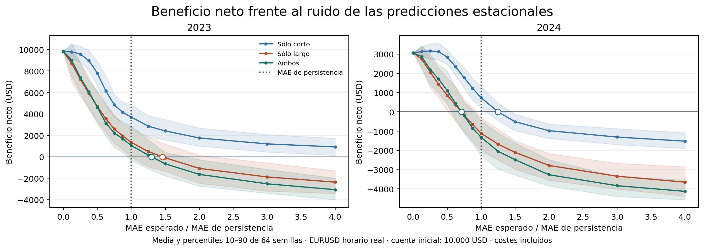

# Barrido factorial de ruido estacional y contraste con predicciones reales

EURUSD H1, replay historico 2023 y 2024 por separado. Rama 462 puente directo,
salida temprana por SL, parametros sin reajuste. Largo = 6/24/48 h abre y
participa en cierre. Corto = 1-5 h solo participa en cierre. Cuenta USD 10000,
apalancamiento 50, margen hasta 10%, mismo calendario y perfil de costes
configurados de 462. Velas bid reales; ask estimado, no fills de broker.



**Figuras vectoriales:** [beneficio](return_pct.pdf), [Sharpe](sharpe.pdf),
[superficie conjunta](surface.pdf), [MAE y predictores por horizonte](mae.pdf).

## Diseno

Para cada ano y horizonte h, N_h = media de |S(t+h)-S(t)| en las filas
disponibles para ese horizonte en el replay. Por eso los MAE no coinciden
necesariamente con el panel 459, que exigia todos los destinos de una cabeza.
Para puntuar la cuenta se conservan exactamente los ticks y ausencias de 462.
La escala anual se usa para describir el experimento retrospectivo; no entra
en las decisiones del controlador. Para un nivel k del grupo,
pronostico = cambio ideal + Z * k * N_h * sqrt(pi/2); Z normal estandar
independiente por tick y horizonte. No se cambia el precio ni se vuelve
a descomponer STL. k=1 significa igualdad de MAE esperado con persistencia,
**no** pronosticar con persistencia. La persistencia efectiva produce cero
incremento y no abre ninguna orden.

14 niveles por grupo entre 0 y 4, 64 semillas por celda, 2 anos. Mismos
errores estandarizados en las celdas de una semilla; semillas distintas por
ano. Corto aislado fija largo a cero, largo aislado fija corto a cero, y la
diagonal incrementa ambos. El resto del factorial mide su interaccion.
Beneficio = equity final menos capital inicial, en USD; Sharpe descriptivo
con tasa libre de riesgo cero, ultimos marks de cada fecha UTC con barras,
desviacion muestral de retornos diarios y factor sqrt(252). Las curvas son
medias y las bandas P10-P90 de semillas, no incertidumbre sobre anos futuros.
El cruce es la primera interseccion descendente de la media con cero,
interpolada entre celdas consecutivas sin asumir monotonia ni extrapolar.
El IC Monte Carlo se calcula con 2000 remuestreos de curvas enteras de
semillas. No es un intervalo de generalizacion de mercado.

|Ruido aplicado|Cruce 2023 / naive|Cruce 2024 / naive|
|---|---:|---:|
|Solo corto|No observado hasta 4|1.250|
|Solo largo|1.460|0.710|
|Ambos|1.299|0.711|

En 2024, la banda Monte Carlo del cruce conjunto fue 0.682-0.743.
No es un MAE necesario por separado para cada horizonte: representa un
vector de ocho errores sobre la diagonal ensayada. Thresholds.csv (en
minuscula) y absolute_thresholds.csv contienen intervalos y unidades reales.

## Controles con la red

Se recargaron los cuatro campeones en CPU, sin entrenamiento. Antes del
replay se verifico el MAE de cada uno en su panel archivado a 1e-6 absoluto.
En 2024, el afinado dio +16.01% con solo el corto real, -7.85% con solo el
largo real y -20.64% con ambos reales; este ultimo hizo 399 operaciones.
El congelado dio +14.07%, -14.95% y -25.83%, respectivamente.
Los sustitutos gaussianos con los mismos ocho MAE realizados (reescalado por
horizonte y semilla para este control) dieron medias de -7.83% para el
afinado y -9.70% para el congelado. Igual MAE no implica igual decision.
No se identifica aqui la causa de la diferencia: para ello hacen falta
residuos por fase de operacion, horizonte y regimen. No se atribuye al
predictor un test independiente de la seleccion historica del encoder.

## Artefactos y reproduccion

- sweep.csv.gz: las 25088 cuentas por ano, semilla y dos niveles; retorno,
  drawdown, numero de ordenes/compras/aciertos y Sharpe.
- noise.csv.gz: N_h, soporte y MAE realizado a k=1 por semilla; se multiplica
  por el nivel para obtener el MAE exacto a cualquier k, sin promediar escalas.
- controls.csv: oraculo, persistencia y replay de predictores completos e hibridos.
- matched.csv: rendimientos gaussianos con MAE igualado exactamente a cada red.
- reference_checks.json: comparaciones con el motor de referencia Python
  (retorno, drawdown, ordenes, compras y aciertos; tolerancia 1e-7).

Desde agent-multi (SRC = artefactos de 459, BUNDLE = bundle 61, BARS y RECIPE
son el directorio de barras y el JSON usados en 462):

```bash
PYTHONPATH=. python tools/role463_real_signals.py "$SRC" "$BUNDLE" /tmp/real463.npz
PYTHONPATH=. python tools/role463_noise.py "$SRC" "$BARS" "$RECIPE" /tmp/real463.npz "$OUT"
python tools/role463_figures.py "$OUT"
```

El export usa el entorno Torch del bundle. El barrido usa numpy, pandas,
pyarrow y numba; las figuras usan matplotlib. No se modifica predictor.
